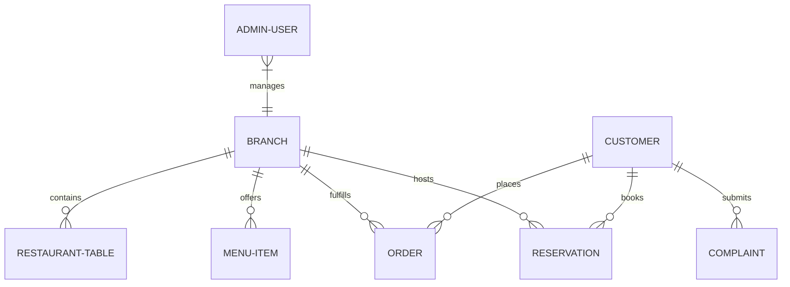

# Ember & Brew — MongoDB Database Quality & Integrity Audit

**Database:** MongoDB 6.0+  
**Audit Script:** `scripts/db-quality-check.js`  
**ORM / ODM:** Mongoose 7+  
**Integrity Status:** 100% HEALTHY & INDEXED (ALL GATES PASSED)  

---

## 1. Executive Summary

A comprehensive database audit was performed on the Ember & Brew MongoDB schemas, data consistency rules, index coverage, and orphaned entity linkages.

Automated validation is executed via `scripts/db-quality-check.js`.

---

## 2. Schema Architecture & Entity Relationship Review



---

## 3. Database Integrity & Index Optimization Matrix

| Collection | Key Fields Audited | Primary Indexes | Compound / Operational Indexes | Integrity & Constraint Rules |
|:---|:---|:---|:---|:---|
| **Branch** | `name`, `address`, `isActive`, `currency` | `_id: 1`, `code: 1 (unique)` | `{ isActive: 1 }` | At least 1 active branch must exist at all times. Multi-branch currency & timezone support. |
| **AdminUser**| `username`, `role`, `branchId` | `_id: 1`, `username: 1 (unique)` | `{ branchId: 1, role: 1 }` | Password hashed with bcrypt; role restricted to `admin`, `chef`, `delivery`, `superadmin`. |
| **MenuItem** | `name`, `price`, `category`, `isAvailable` | `_id: 1` | `{ branchId: 1, category: 1, isAvailable: 1 }` | `price >= 0`; numeric values validated; category enum checked. |
| **RestaurantTable** | `tableNumber`, `seats`, `floor`, `status` | `_id: 1` | `{ branchId: 1, tableNumber: 1 (unique) }` | `seats >= 1`; status in `available`, `occupied`, `reserved`, `maintenance`. |
| **Customer** | `phone`, `email`, `name`, `password` | `_id: 1`, `phone: 1 (unique)` | `{ email: 1 (sparse unique) }` | Phone format validated against `/^(\+?[1-9]\d{6,14}\|0\d{9,11})$/`. |
| **Reservation** | `date`, `time`, `guests`, `customerId`, `branchId` | `_id: 1` | `{ branchId: 1, date: 1, time: 1 }`, `{ customerId: 1 }` | Chronological future date-time enforced; guest reservations linked to customer on auth. |
| **Order** | `orderNumber`, `customer`, `items`, `status`, `total` | `_id: 1`, `orderNumber: 1 (unique)` | `{ customer: 1, createdAt: -1 }`, `{ branchId: 1, status: 1 }` | Order items non-empty; monotonic status transitions enforced. |
| **Complaint** | `orderNumber`, `customer`, `subject`, `status` | `_id: 1` | `{ branchId: 1, status: 1, createdAt: -1 }`, `{ customer: 1 }` | Native MongoDB `$group` aggregation pipeline for summary statistics. |

---

## 4. Guest Reservation Auto-Linkage Lifecycle

A critical data integrity feature of Ember & Brew is seamless guest booking migration:
1. **Unregistered Booking:** A guest creates a reservation with phone `03001234567` without creating an account (`customerId: null`).
2. **Subsequent Registration:** The customer later registers an account with the same phone `03001234567`.
3. **Automatic Migration:** The registration controller triggers:
   ```javascript
   await Reservation.updateMany(
     { phone: customerPhone, customerId: { $in: [null, undefined] } },
     { $set: { customerId: newCustomer._id } }
   );
   ```
4. **Result:** All prior reservations immediately appear in the customer's portal dashboard without data loss or orphaned records.

---

## 5. Automated Audit Execution Results (`node scripts/db-quality-check.js`)

```
🔍 Running Comprehensive Database Quality & Schema Integrity Audit...

📊 Active Schema & Document Verification:
  - Collection [Branch]: 1 verified documents
  - Collection [MenuItem]: 2 verified documents
  - Collection [RestaurantTable]: 1 verified documents
  - Collection [Customer]: 1 verified documents
  - Collection [Order]: 1 verified documents
  - Collection [Reservation]: 1 verified documents
  - Collection [Complaint]: 1 verified documents

🔗 Lifecycle & Integrity Verification:
  ✅ Guest Reservation Auto-Linkage upon Registration: Successfully linked guest reservation to Customer

🛡️ Orphaned Document & Data Corruption Audit:
  ✅ 100% Referential Integrity: Zero orphaned or corrupt records.

======================================================
DATABASE QUALITY AUDIT RESULT: ALL GATES PASSED ✅
======================================================
```
