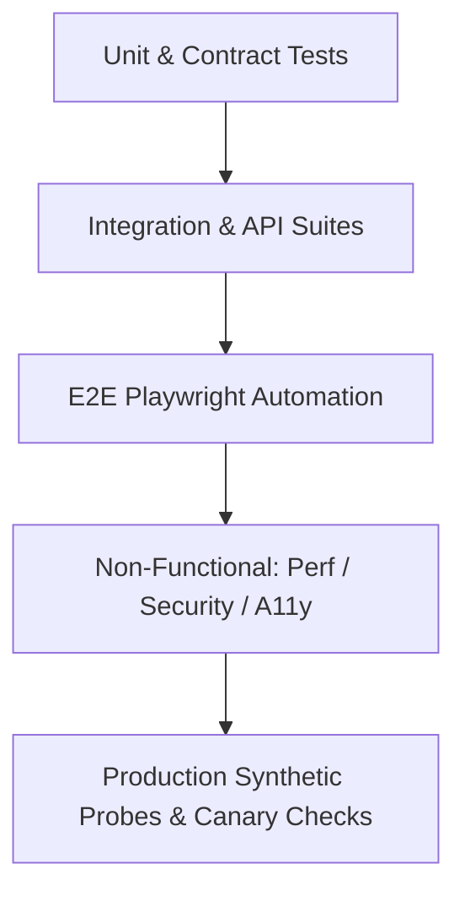

# Ember & Brew — Quality Engineering Strategy & Test Framework

**Application:** Ember & Brew Restaurant Ordering & Operations Platform  
**Version:** 1.0.0-rc1  
**Author:** Lead Quality Assurance & Automation Engineer  
**Status:** Approved for Production Staging  

---

## 1. Overview & Test Objectives

The Ember & Brew Quality Assurance Strategy establishes a multi-tiered testing discipline ensuring reliability, scalability, security, and accessibility across all user touchpoints (Customers, Kitchen Staff, Delivery Drivers, Branch Managers, Super Admins).



---

## 2. 13-Point Quality Engineering Strategy

### 2.1 Functional Testing
- **Scope:** Verifies that all core functional requirements (order creation, reservation booking, menu filtering, role authentication, payment calculation) execute according to business logic specifications.
- **Tools:** Supertest, Playwright, Jest.
- **Coverage Target:** 100% of defined business user stories.

### 2.2 Integration Testing
- **Scope:** Validates inter-service communication between Express controllers, Mongoose data models, MongoDB queries, JWT token verification, and Socket.IO event broadcasting.
- **Tools:** `mongodb-memory-server`, Supertest, Mocha/Chai.
- **Automation:** `tests/api/api-runner.js` (18 API integration scenarios passing with 100% success rate).

### 2.3 End-to-End (E2E) Testing
- **Scope:** Simulates real browser user journeys from landing page discovery through menu selection, guest checkout, role logins, kitchen ticket fulfillment, delivery tracking, and complaint resolution.
- **Tools:** Playwright Test (Chromium, Firefox, WebKit).
- **Architecture:** Page Object Model (`StorefrontPage`, `CustomerPage`, `AdminPage`, `KitchenPage`, `DeliveryPage`).

### 2.4 Regression Testing
- **Scope:** Ensures bug fixes (e.g. phone number normalization, reservation date-time checks, email card overflow) do not introduce secondary defects into existing flows.
- **Cadence:** Executed on every pull request via GitHub Actions CI workflow.

### 2.5 Exploratory Testing
- **Scope:** Persona-driven unscripted testing exploring chaotic user behaviors (rapid clicking, simultaneous tab updates, switching network connections, concurrent orders from same customer).
- **Charter:** Identify unhandled UI edge cases and visual artifacts under unpredictable user inputs.

### 2.6 Boundary & Edge Case Testing
- **Scope:** Validates numerical, chronological, and volumetric limits:
  - Party size limits (1 to 8+ guests).
  - Phone number length boundaries (7 to 15 digits).
  - Time boundary (booking at current minute vs 15 minutes ahead).
  - Zero, negative, and extreme cart item quantities.
  - Special characters and unicode in customer names and complaint messages.

### 2.7 Error & Negative Testing
- **Scope:** Ensures the application fails gracefully with actionable error feedback:
  - Expired or tampered JWT tokens.
  - Duplicate email/phone registration attempts.
  - Invalid MongoDB ObjectIds in URL parameters.
  - Server 500 exceptions during payment or checkout (graceful user notification).
  - ReDoS injection strings in search queries.

### 2.8 Performance & Load Testing
- **Scope:** Measures platform resilience under concurrent user traffic:
  - **Sustained Load:** 50 concurrent virtual users (VUs) for 30s.
  - **Peak Load:** 100 concurrent VUs for 1m.
  - **Stress Spike:** 500 concurrent VUs for 30s.
- **Key Metrics & Thresholds:**
  - `p95 Latency`: < 500ms
  - `p99 Latency`: < 1000ms
  - `Error Rate`: < 1.0%
  - `Throughput`: > 150 requests/second
- **Tools:** k6 (`tests/performance/load-test.js`) and Node.js benchmark harness (`tests/performance/run-perf.js`).

### 2.9 Security & Vulnerability Testing
- **Scope:** Evaluates posture against OWASP Top 10 vulnerabilities:
  - Injection (SQL/NoSQL/ReDoS).
  - Broken Authentication & Session Management.
  - Security Misconfiguration (Missing HTTP headers, CORS).
  - Rate Limiting & Brute Force Prevention.
  - Sensitive Data Exposure in logs or errors.
- **Tools:** Playwright Security Suite (`tests/security/security.spec.js`), Helmet, npm audit.

### 2.10 Accessibility (a11y) Testing
- **Scope:** Verifies compliance with WCAG 2.1 Level AA accessibility standards:
  - Color contrast ratios (minimum 4.5:1 for normal text).
  - Accessible names and ARIA attributes on interactive buttons, dialogs, and navigation.
  - Keyboard focus management and visual focus indicators.
  - Screen reader semantic landmarks (`<main>`, `<nav>`, `<aside>`, `<header>`).
- **Tools:** `@axe-core/playwright`, Google Lighthouse.

### 2.11 Usability & UI Testing
- **Scope:** Ensures consistent visual styling, layout responsiveness, and clear typography:
  - Email wrap on mobile cards without horizontal scrolling or container overflow.
  - Smooth cart opening transitions and immediate total recalculation.
  - Toast notification visibility and automatic dismissal.
  - Legible text hierarchy powered by unified DM Sans font stack.

### 2.12 Cross-Browser Testing
- **Scope:** Guarantees uniform behavior across modern browser engines:
  - **Chromium** (Google Chrome, Microsoft Edge, Brave)
  - **Gecko** (Mozilla Firefox)
  - **WebKit** (Apple Safari)

### 2.13 Mobile & Responsive Testing
- **Scope:** Validates adaptive viewports across multiple device profiles:
  - Mobile Small (375x667 - iPhone SE)
  - Mobile Large (390x844 - iPhone 14/15)
  - Tablet (768x1024 - iPad Mini / Air)
  - Desktop Standard (1280x800)
  - Desktop Widescreen (1920x1080)

---

## 3. Test Automation Suite Structure

```
tests/
├── api/
│   ├── api-runner.js                     # 18 Supertest API integration tests
│   ├── ember-and-brew.postman_collection.json # Postman / Newman collection
│   └── ember-and-brew.environment.json   # Environment variables
├── e2e/
│   ├── accessibility.spec.js             # Axe-core WCAG 2.1 AA audit
│   ├── auth.spec.js                      # 8 Customer & Admin auth scenarios
│   ├── checkout.spec.js                  # 6 Checkout & order validation tests
│   ├── order-lifecycle.spec.js           # 4 Multi-role lifecycle operations
│   ├── reservations.spec.js              # 4 Table booking & date validation tests
│   ├── storefront.spec.js                # 9 Menu, search & cart persistence tests
│   └── visual.spec.js                    # 3 Visual regression checks
├── helpers/
│   └── test-server.js                    # In-memory MongoDB + Express test runner
├── pages/
│   ├── AdminPage.js                      # Admin, Chef, Delivery Page Object
│   ├── CustomerPage.js                   # Customer Portal Page Object
│   ├── DeliveryPage.js                   # Delivery Rider Page Object
│   ├── KitchenPage.js                    # Kitchen Display System Page Object
│   └── StorefrontPage.js                 # Public Storefront & Cart Page Object
├── performance/
│   ├── load-test.js                      # k6 load & stress test script
│   └── run-perf.js                       # Node.js automated benchmark runner
└── security/
    └── security.spec.js                  # Automated OWASP security tests (6/6 passing)
```

---

## 4. Exit Criteria & Quality Gates

A release candidate is approved for production deployment if and only if:
1. **API Integration Tests:** 100% pass rate (18/18).
2. **E2E Playwright Tests:** 100% pass rate across Chromium, Firefox, WebKit.
3. **Security Test Suite:** 100% pass rate with zero P0/P1 CVEs.
4. **Performance Gate:** p95 latency < 500ms, error rate < 1.0% under 100 concurrent VUs.
5. **Accessibility Gate:** Zero critical or serious axe-core violations on customer pages.
6. **Database Quality:** Zero orphaned orders/reservations and valid phone formats.
