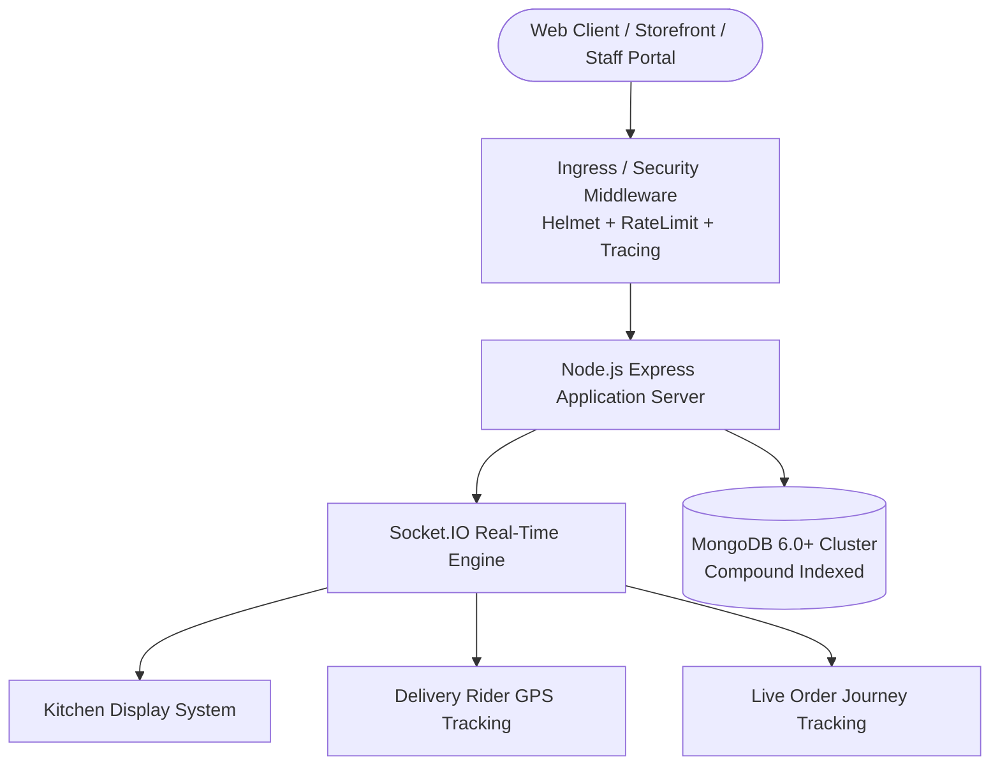

# Ember & Brew — Café Ordering & Operations Platform

[](https://github.com/abrarnazir22/Restaurant-ordering-system/actions/workflows/ci.yml)
[](SECURITY_REPORT.md)
[](ACCESSIBILITY_REPORT.md)
[](docs/pm/04-test-exit-report.md)
[](openapi.yaml)

A production-grade, full-stack Node.js / Express / MongoDB café and restaurant platform with real-time WebSocket orchestration, role-based operations boards, automated quality engineering suites, and AI-assisted conversational workflows.

---

## 📑 Quick Navigation & Engineering Deliverables

- 📘 [Comprehensive Engineering Review (32 Issues Audited)](ENGINEERING_REVIEW.md)
- 🎯 [Full Quality Engineering & Test Strategy (13 Dimensions)](QA_STRATEGY.md)
- 🐛 [Complete Defect Repository (BUG-001 to BUG-025)](bugs/BUG_INDEX.md)
- 🔍 [5-Why Root Cause Analyses (RCA-001 to RCA-005)](rca/RCA-001.md)
- 🤖 [AI-Assisted QE & Multi-LLM Evaluation](AI_REPORT.md)
- 📋 [AI Model Evaluation & Benchmarking Protocol](docs/ai-evaluation/AI_EVALUATION_PLAN.md)
- ⚡ [k6 Load & Performance Engineering Report](docs/performance/LOAD_TEST_REPORT.md)
- 🔒 [OWASP Top 10 & API Security Report](SECURITY_REPORT.md)
- ♿ [Accessibility (a11y) & WCAG 2.1 AA Audit](ACCESSIBILITY_REPORT.md)
- 🗄️ [MongoDB Data Quality & Schema Integrity Audit](DATABASE_QUALITY.md)
- 📋 [Project Management & Release Artifacts](docs/pm/01-sprint-plan.md)
- 🚀 [Production Readiness & Architectural Certification](PRODUCTION_READINESS.md)
- 📄 [Final Quality Engineering & Remediation Report](docs/remediation/FINAL_REMEDIATION_REPORT.md)

---

## 🏛️ System Architecture



---

## 🚀 Portals & Core Modules

| Portal | URL | Purpose & Target Persona |
|---|---|---|
| **Storefront** | `/` | Guest and customer menu browsing, real-time cart, dine-in / delivery checkout, live journey tracking. |
| **Customer Portal** | `/customer` | Account management, order history, active table reservations, complaint filing. |
| **Admin Dashboard** | `/admin` | Menu catalog management, active order queue, delivery rider assignment, revenue analytics. |
| **Kitchen Display (KDS)** | `/kitchen` | Real-time chef ticket board with Station filters, bump workflows, and prep timing. |
| **Delivery Management** | `/delivery` | Rider order dispatch, GPS coordinates broadcast, and delivery confirmation. |
| **API Documentation** | `/api-docs` | Interactive Swagger UI powered by OpenAPI 3.0 specification (`openapi.yaml`). |

---

## 🧪 Automated Testing & Quality Engineering Commands

| Test Suite | Command | Description |
|---|---|---|
| **All Automated Suites** | `npm run test:all` | Executes API integration, DB integrity, synthetic probes, performance benchmark, and Playwright E2E. |
| **API Integration Suite** | `npm run test:api` | 18 Supertest API scenarios across 10 core service categories (100% Pass Rate). |
| **Playwright E2E Suite** | `npm run test:e2e` | End-to-end browser user journeys (auth, storefront, reservations, checkout, order lifecycle). |
| **OWASP Security Suite** | `npm run test:security` | Security headers, ReDoS protection, rate limiting, and RBAC authorization barriers. |
| **Accessibility Audit** | `npm run test:a11y` | Automated WCAG 2.1 AA audits via `@axe-core/playwright` across all web portals. |
| **k6 Load Benchmark (50 VUs)** | `npm run test:k6:50` | k6 multi-endpoint performance load test at 50 concurrent virtual users. |
| **k6 Load Benchmark (100 VUs)**| `npm run test:k6:100` | k6 multi-endpoint performance load test at 100 concurrent virtual users. |
| **Performance Benchmark** | `npm run test:perf` | High-concurrency throughput and latency percentile (p50/p95/p99) load benchmark. |
| **Database Integrity** | `npm run db:quality` | MongoDB orphaned entity checks, price sanity, schema type compliance, and index audits. |
| **Synthetic Health Monitor** | `npm run monitor` | Continuous synthetic user transaction probe verifying operational health. |

---

## 🐳 Docker Deployment

```bash
# Build and start services via Docker Compose
docker-compose up -d --build

# View container logs
docker-compose logs -f app

# Run health check probe
curl http://localhost:3000/api/health
```

---

## 📦 Production Credentials Configuration

Copy `.env.example` to `.env` and configure production secrets:

```env
PORT=3000
MONGODB_URI=mongodb://localhost:27017/restaurant
JWT_SECRET=your_production_secret_jwt_key
DEFAULT_ADMIN_PASSWORD=your_secure_admin_password
DEFAULT_CHEF_PASSWORD=your_secure_chef_password
DEFAULT_DELIVERY_PASSWORD=your_secure_delivery_password
ANTHROPIC_API_KEY=your_anthropic_api_key_optional
```
