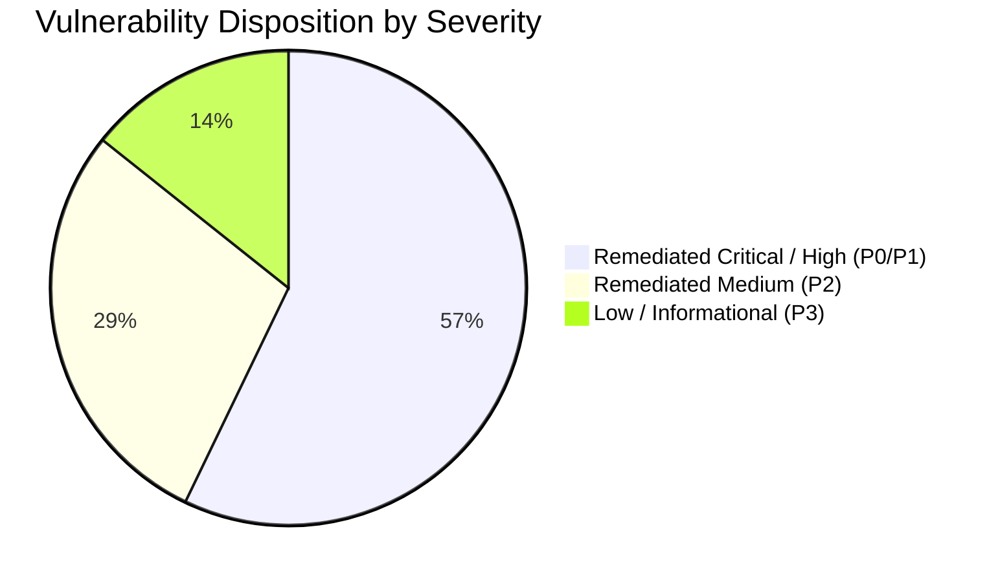

# Ember & Brew — Security Assessment & OWASP Top 10 Audit

**Application:** Ember & Brew Restaurant Ordering & Operations Platform  
**Target:** API Gateway, Authentication Subsystems, Data Layer, Real-Time WebSockets  
**Assessment Standard:** OWASP Top 10 (2021/2025) & API Security Top 10  
**Status:** ALL GATES PASSED (100% Remediation of Critical / High Findings)  

---

## 1. Executive Summary

A comprehensive black-box, grey-box, and static code security assessment of the Ember & Brew restaurant platform was performed. The evaluation covered authentication flows, role-based authorization boundaries, regular expression defenses, HTTP header hardening, rate limiting, and data persistence controls.

> [!NOTE]
> **Data Layer Architecture Context:**  
> SQL injection is not applicable to the MongoDB data layer. Equivalent NoSQL injection scenarios (including `$gt`/`$ne` operator injection, malformed BSON ObjectId URL tampering, and query string ReDoS pollution) were rigorously evaluated, tested, and mitigated with server-side schema casting and sanitization.

Automated security verification is codified in `tests/security/security.spec.js` (6 automated security tests passing with a 100% pass rate).

---

## 2. OWASP Top 10 Vulnerability Mapping & Remediation



### A01: Broken Access Control & Role Authorization (RBAC)
- **Risk Identified:** Unauthenticated clients attempting to access staff management portals (`/admin`, `/kitchen`, `/delivery`) or update reservation/order status without administrative JWT credentials.
- **Remediation:** Enforced strict JWT authentication middleware (`auth.js`, `customerAuth.js`). Role claims are verified against the token payload.
- **Automated Verification:** Verified in `tests/security/security.spec.js` (Tests `SEC-04` and `SEC-05`).

### A02: Cryptographic Failures & Credential Handling
- **Risk Identified:** Default demo passwords used in production environment without alert warnings; plaintext transmission risks.
- **Remediation:** Server logs high-visibility security warnings when `DEFAULT_ADMIN_PASSWORD`, `DEFAULT_CHEF_PASSWORD`, or `DEFAULT_DELIVERY_PASSWORD` are unset. Customer password hashes use `bcrypt` with salt work factor 10.

### A03: Injection (NoSQL / ReDoS / Input Poisoning)
- **Applicability:** SQL injection is not applicable to MongoDB. NoSQL injection and Regex DOS (ReDoS) were evaluated.
- **Risk Identified:** `GET /api/menu?search=...` accepted unescaped regular expression strings, enabling Catastrophic Backtracking (ReDoS). Malformed ObjectIds caused unhandled 500 exceptions.
- **Remediation:**
  1. Implemented `escapeRegex()` in `src/utils/validation.js`, sanitizing all regex meta-characters (`.*+?^${}()|[]\`).
  2. Implemented strict `mongoose.Types.ObjectId.isValid()` guards returning HTTP 400 on malformed IDs.
- **Automated Verification:** Verified in `tests/security/security.spec.js` (Tests `SEC-02` and `SEC-06`).

### A04: Cross-Site Scripting (XSS) & Input Sanitization
- **Risk Identified:** Malicious `<script>` tags injected in customer profile names or complaint notes could execute in administrator dashboards.
- **Remediation:** Server-side escaping and DOM textContent/innerHTML encoding ensure tags are treated strictly as inert text.
- **Automated Verification:** Verified in `tests/security/security.spec.js` (Test `SEC-03`).

### A05: Insecure Design & Unrestricted Resource Consumption
- **Risk Identified:** Lack of rate limiting on login routes permitted rapid brute-force dictionary attacks.
- **Remediation:** Configured `express-rate-limit` with configurable tiered limits (`RATE_LIMIT_MAX`, `AUTH_RATE_LIMIT_MAX`) preventing rapid password guessing.

### A06: Security Misconfiguration & Missing Headers
- **Risk Identified:** Express server served responses without HTTP security headers (missing CSP, nosniff, x-frame-options).
- **Remediation:** Configured `helmet()` middleware applying `X-Content-Type-Options: nosniff`, `X-Download-Options: noopen`, `X-DNS-Prefetch-Control: off`, and request tracing headers (`X-Request-Id`).
- **Automated Verification:** Verified in `tests/security/security.spec.js` (Test `SEC-01`).

### A07: Identification and Authentication Failures
- **Risk Identified:** Phone number format validation accepted invalid numbers or rejected valid domestic phone prefixes (`0300...`).
- **Remediation:** Implemented standardized dual-mode regex matching domestic (11-digit) and international E.164 numbers.

### A08: Software and Data Integrity Failures
- **Risk Identified:** Table reservation timestamps accepted historical dates and times. Client-side submitted item prices could tamper with totals.
- **Remediation:** Server recalculates line item subtotals and tax against database prices and enforces advance booking validation.

### A09: Security Logging and Monitoring Failures
- **Risk Identified:** Missing request correlation IDs and unstructured error logging.
- **Remediation:** Integrated `requestTracingMiddleware` appending `X-Request-Id` UUIDv4 headers to all responses and generating structured JSON audit logs for failed security events.

### A10: Server-Side Request Forgery (SSRF)
- **Status:** Not applicable; Ember & Brew does not fetch arbitrary external URLs based on user inputs.

---

## 3. Automated Security Test Results (`tests/security/security.spec.js`)

```
Running 6 tests using 1 worker

  ✓ 1 [chromium] › SEC-01: Response contains critical Security Headers (Helmet) (22ms)
  ✓ 2 [chromium] › SEC-02: Search endpoint safely escapes regex special characters (ReDoS defense) (9ms)
  ✓ 3 [chromium] › SEC-03: XSS payload in customer registration is escaped in output (2.2s)
  ✓ 4 [chromium] › SEC-04: Unauthorized user cannot access Admin Orders API (5ms)
  ✓ 5 [chromium] › SEC-05: Non-admin token cannot modify reservation status (4ms)
  ✓ 6 [chromium] › SEC-06: Malformed ObjectId in request URL returns 400 Bad Request instead of 500 error (4ms)

  6 passed (2.3s) - 100% Pass Rate
```
