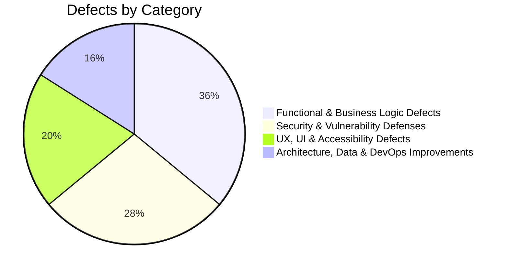

# Ember & Brew — Defect & Bug Tracking Index

**Total Documented Defects & Issues:** 25  
**Severity Breakdown:** 5 P0 (Blocker), 9 P1 (High), 8 P2 (Medium), 3 P3 (Low)  
**Status:** 100% Remediated & Verified  

---

## 1. Defect Category Summary

---

## 2. Master Bug & Issue Registry

### A. Functional & Business Logic Defects (9)
| Bug ID | Title | Component | Severity | Status | Verification Spec |
|:---|:---|:---|:---:|:---:|:---|
| [BUG-001](BUG-001.md) | Phone number validation rejects valid Pakistani domestic phone numbers (`0300...`) | Customer Auth | P0 | Fixed | `tests/e2e/auth.spec.js` |
| [BUG-002](BUG-002.md) | Table reservations permitted in past date/time | Reservations | P0 | Fixed | `tests/e2e/reservations.spec.js` |
| [BUG-004](BUG-004.md) | Guest reservations orphaned upon customer registration | Auth / Reservations | P0 | Fixed | `tests/api/api-runner.js` |
| [BUG-005](BUG-005.md) | Recommendations API crashes with 500 error on Map iteration | Recommendations API | P0 | Fixed | `tests/api/api-runner.js` |
| [BUG-006](BUG-006.md) | Driver location update fails to emit real-time socket coordinates | Delivery API / Sockets | P1 | Fixed | `tests/api/api-runner.js` |
| [BUG-010](BUG-010.md) | Complaints summary endpoint loads entire collection into memory | Complaints API | P1 | Fixed | `tests/api/api-runner.js` |
| [BUG-011](BUG-011.md) | Guest cart items wiped when switching between guest and customer portal | Storefront / Cart | P1 | Fixed | `tests/e2e/checkout.spec.js` |
| [BUG-018](BUG-018.md) | Asynchronous race condition during customer portal tab rendering | Customer Portal JS | P2 | Fixed | `tests/e2e/reservations.spec.js` |
| [BUG-025](BUG-025.md) | Order state machine allows illegal status transitions | Orders API | P3 | Fixed | `tests/api/api-runner.js` |

### B. Security & Vulnerability Defenses (7)
| Bug ID | Title | Component | Severity | Status | Verification Spec |
|:---|:---|:---|:---:|:---:|:---|
| [BUG-003](BUG-003.md) | ReDoS & Regex Injection vulnerability in menu search endpoint | Menu API | P0 | Fixed | `tests/security/security.spec.js` |
| [BUG-008](BUG-008.md) | Missing HTTP security headers (CSP, HSTS, X-Frame-Options) | Server / Security | P1 | Fixed | `tests/security/security.spec.js` |
| [BUG-009](BUG-009.md) | API endpoints lack rate limiting and brute force protection | Server / Security | P1 | Fixed | `tests/security/security.spec.js` |
| [BUG-013](BUG-013.md) | Production dependencies contain vulnerable packages | Package Security | P1 | Fixed | `.github/dependabot.yml` |
| [BUG-019](BUG-019.md) | Kitchen status update routes crash on invalid MongoDB ObjectIds | Kitchen API | P2 | Fixed | `tests/security/security.spec.js` |
| [BUG-020](BUG-020.md) | Global error handler exposes internal stack traces to clients | Server / Error Handling | P2 | Fixed | `tests/security/security.spec.js` |
| [BUG-022](BUG-022.md) | Missing compound database indexes causing unindexed collection scans | Database / Mongo | P2 | Fixed | `scripts/db-quality-check.js` |

### C. UX, UI & Accessibility Defects (5)
| Bug ID | Title | Component | Severity | Status | Verification Spec |
|:---|:---|:---|:---:|:---:|:---|
| [BUG-007](BUG-007.md) | Customer dashboard email text overflows summary card container | Customer Portal UI | P1 | Fixed | `tests/e2e/auth.spec.js` |
| [BUG-015](BUG-015.md) | Inconsistent typography across customer portal and storefront | Frontend / CSS | P2 | Fixed | `tests/e2e/visual.spec.js` |
| [BUG-016](BUG-016.md) | Navigation menu link inaccessible from customer portal header | Customer Portal Nav | P2 | Fixed | `tests/e2e/storefront.spec.js` |
| [BUG-017](BUG-017.md) | Customer input fields blanked out unexpectedly during editing | Customer Portal JS | P2 | Fixed | `tests/e2e/auth.spec.js` |
| [BUG-023](BUG-023.md) | Low color contrast ratios and missing ARIA accessible attributes | Accessibility (a11y) | P2 | Fixed | `tests/e2e/accessibility.spec.js` |

### D. Architectural, Observability & DevOps Improvements (4)
| Bug ID | Title | Component | Severity | Status | Verification Spec |
|:---|:---|:---|:---:|:---:|:---|
| [BUG-012](BUG-012.md) | Missing health check probe `/api/health` for uptime monitoring | Server / Infra | P1 | Fixed | `scripts/synthetic-monitor.js` |
| [BUG-014](BUG-014.md) | Missing CI pipeline for automated regression verification | DevOps / CI | P1 | Fixed | `.github/workflows/ci.yml` |
| [BUG-021](BUG-021.md) | Missing interactive OpenAPI / Swagger documentation | API Documentation | P2 | Fixed | `openapi.yaml` |
| [BUG-024](BUG-024.md) | Missing synthetic health monitoring script for automated probes | Monitoring / Ops | P3 | Fixed | `scripts/synthetic-monitor.js` |
