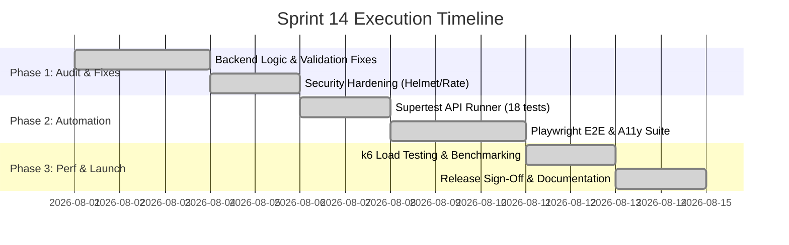

# Sprint Plan: Ember & Brew Quality Hardening & Production Release

**Sprint:** Sprint 14 — Quality & Engineering Hardening  
**Duration:** 2 Weeks (10 Working Days)  
**Sprint Goal:** Remediate 32 identified engineering defects, build automated Playwright and API test suites, harden security and accessibility, and certify the platform for production launch.  

---

## 1. Work Breakdown Structure & Epics

### Epic 1: Core Defect Remediation & Backend Hardening
- **User Stories:**
  - `US-101`: Support Pakistani domestic phone numbers across registration and login.
  - `US-102`: Enforce 15-minute future validation on table reservations.
  - `US-103`: Reconcile guest reservations on customer account creation.
  - `US-104`: Sanitize search inputs against ReDoS attacks.

### Epic 2: Frontend UX & Accessibility Overhaul
- **User Stories:**
  - `US-201`: Resolve email text container overflow on customer summary cards.
  - `US-202`: Standardize DM Sans typography across all customer interfaces.
  - `US-203`: Add accessible ARIA modal semantics and keyboard focus traps.

### Epic 3: Test Automation & CI/CD Pipeline
- **User Stories:**
  - `US-301`: Implement 18 automated API integration tests.
  - `US-302`: Build Playwright E2E suites for auth, menu, checkout, and order lifecycle.
  - `US-303`: Configure GitHub Actions CI workflow and Docker containerization.
