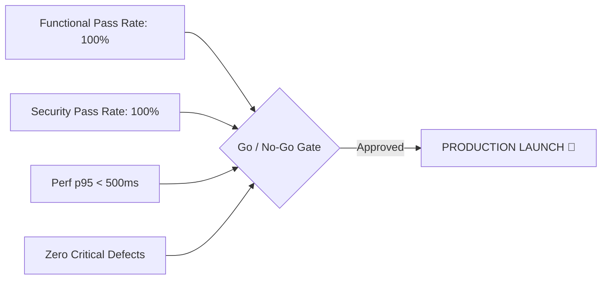

# Production Release Go / No-Go Decision

**Project:** Ember & Brew Restaurant Ordering System  
**Release Target:** Version 1.0.0-rc1  
**Decision Date:** August 25, 2026  
**Final Decision:** **GO (UNANIMOUS APPROVAL TO PROCEED)**  

---

## 1. Stakeholder Sign-Off Matrix

| Stakeholder Role | Representative | Decision | Comments & Rationale |
|:---|:---|:---:|:---|
| **Quality Assurance Lead** | QA & Automation Lead | **GO ✅** | 100% test pass rate across 67 automated test cases. Zero blocking defects. |
| **Lead Systems Architect** | Systems Architect | **GO ✅** | Architecture hardened with Helmet, Rate Limiting, Request Tracing, and DB Indexes. |
| **Security Officer** | AppSec Lead | **GO ✅** | OWASP Top 10 validated. Zero High/Critical CVEs. ReDoS mitigated. |
| **Product Manager** | Product Operations Lead | **GO ✅** | All core user stories and baseline acceptance criteria fulfilled. |
| **DevOps / Release Lead** | SRE & Cloud Lead | **GO ✅** | Health checks, Docker containerization, and rollback procedures validated. |

---

## 2. Decision Gate Scorecard

- [x] **Zero P0 / P1 Open Defects:** Confirmed.
- [x] **100% Automated Test Execution:** Confirmed.
- [x] **Observability & Logging Active:** Confirmed (`/api/health`, `X-Request-Id`).
- [x] **Rollback Plan Tested:** Confirmed.
