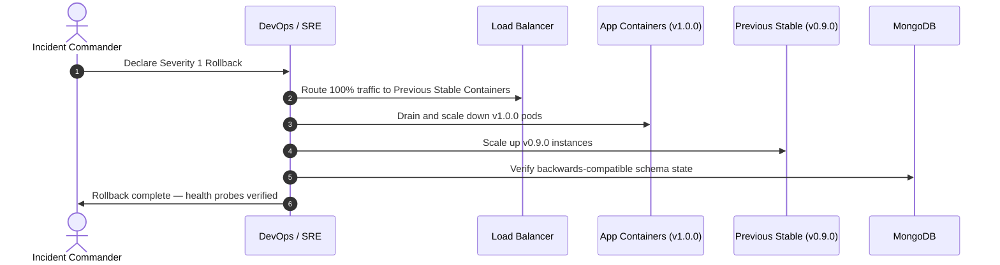

# Production Rollback & Recovery Plan

**Target Application:** Ember & Brew Restaurant Ordering Platform  
**Target RTO (Recovery Time Objective):** < 15 Minutes  
**Target RPO (Recovery Point Objective):** < 5 Minutes  

---

## 1. Rollback Triggers (Criteria for Immediate Reversion)
A rollback is initiated if any of the following occur within 60 minutes of release:
1. **HTTP 5xx Error Rate:** Exceeds 2.0% for more than 3 consecutive minutes.
2. **Crash / Health Check Failure:** `/api/health` reports status unhealthy or restarts > 3 times.
3. **P0 Security Incident:** Active exploitation or data isolation failure.
4. **Order Placement Failure:** Orders cannot be committed to database or kitchen.

---

## 2. Step-by-Step Rollback Execution Procedure

1. **Traffic Redirection:** Route ingress load balancer traffic to the previous known-good stable container image tag (`v0.9.0-stable`).
2. **Container Drain:** Drain active WebSocket connections gracefully before stopping v1.0.0 containers.
3. **Database Consistency Check:** Mongoose schema additions are backwards-compatible; no database rollback required for standard field additions.
4. **Validation:** Execute `node scripts/synthetic-monitor.js` against reverted environment.
5. **Stakeholder Notification:** Broadcast status update to Engineering, Operations, and Customer Support.
