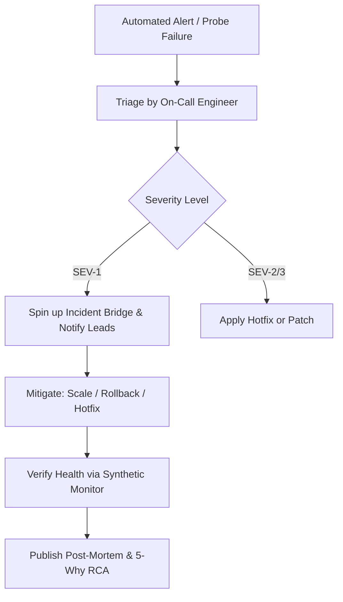

# Incident Response & Escalation Plan (IRP)

**Scope:** Production Availability, API Security, and Operational Incidents  
**On-Call Rotation:** 24/7 SRE & Engineering Tier 2 Escalation  

---

## 1. Incident Severity Definitions & Escalation Matrix

| Severity | Definition | Response SLA | Target Resolution | Escalation Path |
|:---:|:---|:---:|:---:|:---|
| **SEV-1 (Critical)** | Core ordering engine down, payment failure, data breach, zero order placement possible. | **< 15 Mins** | < 2 Hours | On-Call Engineer -> Engineering Lead -> VP of Eng |
| **SEV-2 (High)** | Degradation in kitchen display system, driver GPS latency, or customer portal access. | **< 30 Mins** | < 4 Hours | On-Call Engineer -> Component Tech Lead |
| **SEV-3 (Medium)** | Minor UI layout glitch, non-critical analytics delay, reporting export slow. | **< 2 Hours** | < 1 Business Day | Support Engineer -> Development Team |
| **SEV-4 (Low)** | Informational inquiry, cosmetic font or typo issue. | **< 8 Hours** | Next Sprint | Standard Product Backlog |

---

## 2. Incident Management Workflow

1. **Detection:** Synthetic monitoring alert or APM threshold breach triggers PagerDuty notification.
2. **Containment:** Apply rate throttling, scale container instances, or execute rollback if unresolved within 15 minutes.
3. **Remediation:** Deploy emergency hotfix via fast-track CI/CD pipeline.
4. **Post-Mortem:** Complete structured 5-Why Root Cause Analysis within 24 hours of resolution.
